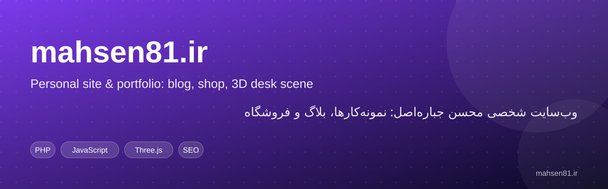

<!-- gen:header -->
<p align="center"></p>

<h1 align="center">mahsen81.ir</h1>
<p align="center"><b>وب‌سایت شخصی محسن جباره‌اصل: نمونه‌کارها، بلاگ و فروشگاه</b><br><i>Personal site & portfolio: blog, shop, 3D desk scene</i></p>
<p align="center">   </p>

<div dir="rtl">

## ✨ امکانات

- صحنه‌ی سه‌بعدی تعاملی
- بلاگ با فید و نقشه‌ی سایت
- فروشگاه ربات‌های ساخته‌شده
- پنل مدیریت و دوزبانه

</div>

## 🚀 Quick start

```bash
Upload to a PHP host.
```

---

<p align="center">ساخته‌شده توسط <a href="https://mahsen81.ir"><b>محسن جباره‌اصل</b></a> — برنامه‌نویسی، طراحی سایت، ربات و هوش مصنوعی<br>
Built by <a href="https://mahsen81.ir">Mohsen Jabbareh-Asl</a> · ⭐ اگر مفید بود، ستاره بدهید · Need a custom version? <a href="https://mahsen81.ir">Get in touch</a></p>
